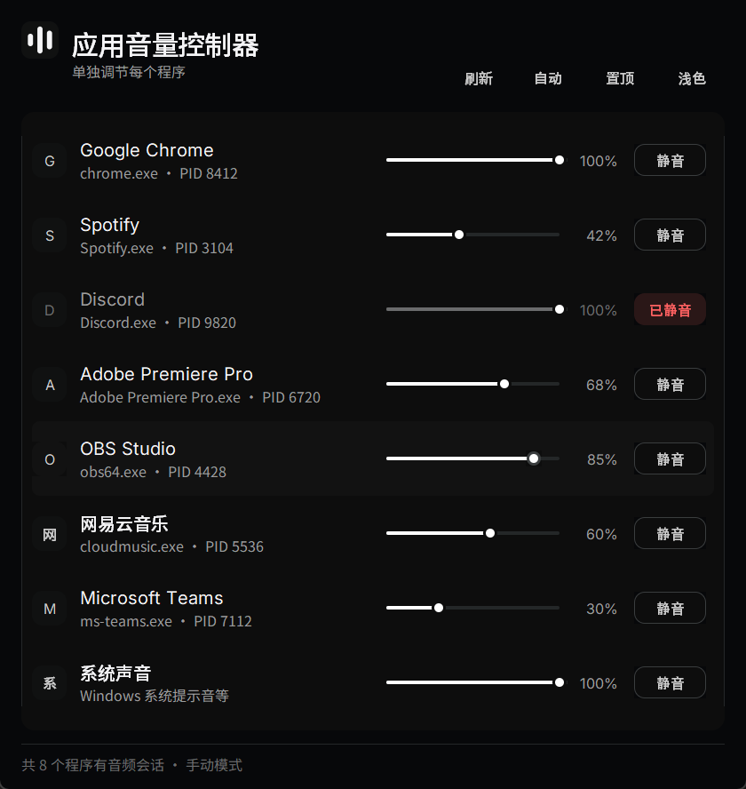

# App Volume Controller

**English** · [简体中文](README.md)

> A lightweight per-app volume mixer for Windows. **One file, one dependency, zero image assets.**

**[⬇ Download installer](https://github.com/gjh66699/app-volume-controller/releases/latest)** · Windows 10/11 · 18 MB · **no Python required**



<sub>Light theme: [docs/screenshot-light.png](docs/screenshot-light.png) · screenshots use demo data</sub>

---

## Why another volume mixer

Windows' built-in mixer does the job, but its UI hasn't moved on since Windows 7. This one does a
single thing: **make "how loud is each app" pleasant to look at and quick to adjust**.

## Features

- One row per app that's currently making sound; multiple sessions from the same process are merged
- Dragging a slider takes effect immediately; mute is a soft red pill, not a slab of red
- **Auto-sync**: apps appear when they start playing and disappear when they quit
- If the volume changes somewhere else, the slider glides there instead of jumping
- Dark and light themes, with a cross-fade when switching
- Always-on-top and manual refresh
- DPI-aware — stays sharp at 1.5x / 2x

## Install

### Option 1: Installer (recommended, no Python needed)

1. Download `AppVolumeController-Setup-x.y.z.exe` from [Releases](https://github.com/gjh66699/app-volume-controller/releases/latest)
2. Double-click it
3. Desktop and Start menu shortcuts are created for you

The installer bundles the Python runtime, so **you don't need Python installed**. It installs to
`%LOCALAPPDATA%\Programs\AppVolumeController` without asking for administrator rights. Uninstall
from Settings → Apps or the Start menu entry — it removes the install directory and shortcuts too.

### Option 2: Run from source (Python 3.9+)

```bash
git clone https://github.com/gjh66699/app-volume-controller.git
cd app-volume-controller
pip install -r requirements.txt
```

`pycaw` is the only direct dependency (`comtypes` and `psutil` come with it).

## Run

Double-click `run.bat`, or:

```bash
pythonw app_volume.pyw
```

`run.bat` tries `pythonw`, then `py -3w`, then `python`, and only complains if none of them is on PATH.

Want a desktop shortcut?

```bash
python make_shortcut.py
```

It writes the `.lnk` binary directly per the MS-SHLLINK spec without instantiating any COM object.
It won't overwrite an existing shortcut; pass `--force` to rebuild.

> If you used the installer, the shortcut is already created — you don't need this script.

## Building your own installer

```bash
pip install pyinstaller
winget install JRSoftware.InnoSetup
python build_installer.py
```

`build_installer.py` runs PyInstaller to produce an onedir bundle (Python runtime included), then
Inno Setup to compress it into a single setup.exe under `installer/Output/`.

## How it works

Everything lives in `app_volume.pyw` — about 2,200 lines. The parts worth a look:

**No image assets.** Rounded panels, the slider knob, the app icon and the scroll masks are all
rasterised at runtime into in-memory `tk.PhotoImage` objects by computing per-pixel **coverage**:
how much of each pixel falls inside the shape becomes the blend factor, which gives anti-aliasing
for free. Nothing is written to disk and Pillow isn't needed — that's how the whole project gets
away with a single dependency.

**Texture cache.** Every raster is cached by `(size, radius, colour)`. The hover fade quantises
colour into 8 steps, so all rows share the same set of images and an animation costs a handful of
`itemconfig` calls.

**Scrolling without rebuilding.** The whole list hangs off a single tag, so scrolling is one `move`
on that tag; dragging a slider touches 3 items in the current row. Measured: full rebuild ~3 ms,
drag update 0.02 ms, scroll frame 0.02 ms.

**60 fps tweens.** Tk's `after(16)` on Windows lands on the next 15.6 ms timer tick, so frame
intervals measured 31 ms — a 130 ms fade got only 6 frames and looked like stepping. Fixed with
`timeBeginPeriod(1)` to raise timer resolution to 1 ms, plus subtracting only the time the frame
itself spent drawing, never the waiting time.

**Drags don't fight callbacks.** The slider is hand-drawn on a Canvas, not a `tk.Scale`, so there's
no `command` callback — a programmatic volume refresh can never accidentally un-mute an app.

## Self-tests

Six suites, no pytest required:

```bash
python app_volume.pyw --selftest       # enumerate sessions, read/write volume
python app_volume.pyw --uitest         # build the UI, check item counts and geometry
python app_volume.pyw --hittest        # 13 checks: click, hover, wheel, drag, mute
python app_volume.pyw --animtest       # 18 checks: tween registration, target colour, final value
python app_volume.pyw --interacttest   # interaction state machine
python app_volume.pyw --benchmark      # per-frame cost of rebuild / drag / scroll
```

The assertions are deliberately **structural** — was the tween registered, did it land on the right
final value — rather than "sample the value at some instant". The latter produces false failures the
moment the machine is busy enough for a tween to finish in a single frame.

## File layout

```
app_volume.pyw          main program (UI + audio + self-tests)
run.bat                 launcher (source mode)
requirements.txt        the single dependency, pycaw
build_installer.py      one-shot build: PyInstaller + Inno Setup
installer/app.iss       Inno Setup script
installer/*.isl         Simplified Chinese language file for the setup wizard
make_icon.py            generates logo.png / logo.svg / app_volume_icon.ico
make_shortcut.py        creates a desktop shortcut (hand-written .lnk binary)
docs/                   README screenshots
logo.svg                vector mark
```

`make_icon.py` applies optical correction at small sizes: at 16/20/24 px the bars are widened and
the gaps narrowed, because drawing them to proportion leaves barely 2 px and they smear. The ICO
renders each size independently and embeds them as PNGs rather than scaling one source image.

## Known limitations

- **Windows only.** Relies on Windows Core Audio (`IAudioSessionManager2`).
- **Volume caps at 100%.** The per-session master volume API tops out at 1.0; going beyond needs an
  APO/DSP, which is out of scope here.
- **Volume isn't remembered.** Each launch reads the current system value — close an app and reopen
  it and it's back to its own default.
- **No keyboard control.** Mouse only, for now.

The last two are things I want to add, not oversights.

## License

[MIT](LICENSE)
