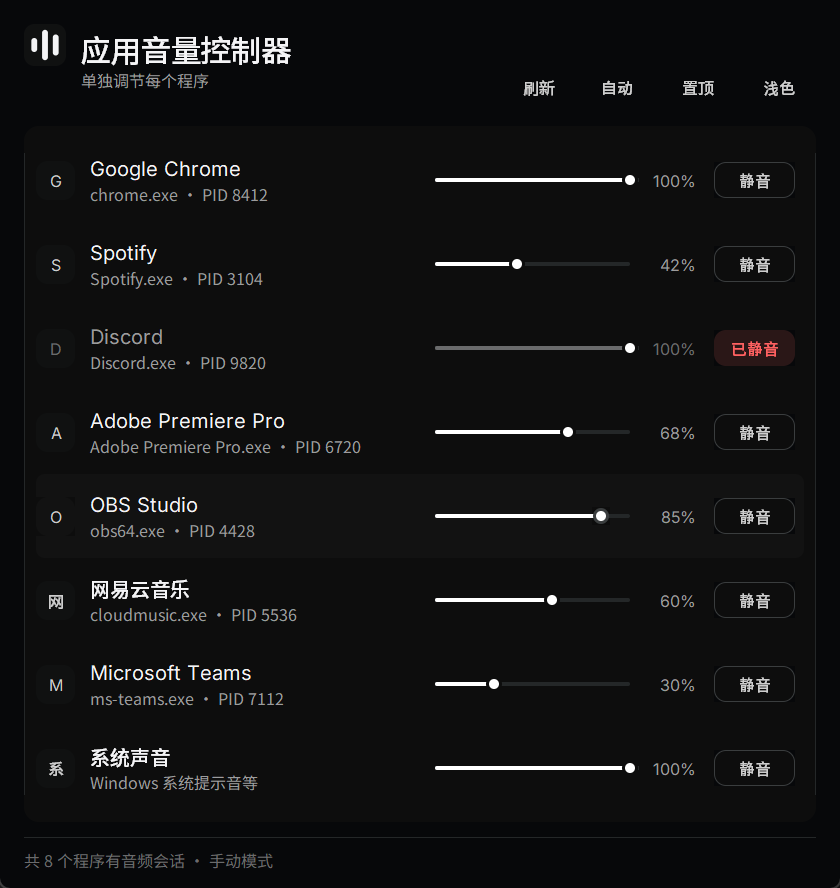

# 应用音量控制器

**简体中文** · [English](README.en.md)

> Windows 上给每个程序单独调音量的轻量小工具。**单文件、一个依赖、零图片资源。**

**[⬇ 下载安装包](https://github.com/gjh66699/app-audio-controller/releases/latest)** · Windows 10/11 · 10 MB · **不需要装 Python**



<sub>浅色主题：[docs/screenshot-light.png](docs/screenshot-light.png) · 截图为演示数据</sub>

---

## 为什么重做一个

系统自带的音量合成器功能是齐的，界面还停在 Windows 7。这个小工具只做一件事：
**把"哪个程序多大声"这件事做得看着舒服、调着顺手**。

## 功能

- 每个正在出声的程序一行，同一个进程的多个音频会话自动合并
- 拖动滑块即时生效；静音是柔红底红字的胶囊，不是一块大红按钮
- **自动同步**：新程序开始出声会自动出现在列表里，退出会自动消失
- 系统里别处改了音量，滑块会滑过去而不是跳过去
- 深浅两套主题，切换时有明暗过渡
- 置顶、手动刷新
- 高 DPI 感知，1.5x / 2x 下不模糊

## 安装

### 方式一：安装包（推荐，不需要 Python）

1. 从 [Releases](https://github.com/gjh66699/app-audio-controller/releases/latest) 下载 `AppVolumeController-Setup-x.y.z.exe`
2. 双击安装
3. 装完桌面和开始菜单都会有快捷方式

安装包内嵌了 Python 运行时，**不需要另外装 Python**。装到 `%LOCALAPPDATA%\Programs\AppVolumeController`，
不需要管理员权限；卸载走「设置 → 应用」或开始菜单里的卸载项，卸载会一并清掉安装目录和快捷方式。

### 方式二：从源码运行（需要 Python 3.9+）

```bash
git clone https://github.com/gjh66699/app-audio-controller.git
cd app-audio-controller
pip install -r requirements.txt
```

只有 `pycaw` 一个直接依赖（`comtypes` / `psutil` 由它自动带上）。

## 运行

双击 `run.bat`，或者：

```bash
pythonw app_volume.pyw
```

`run.bat` 会依次尝试 `pythonw` → `py -3w` → `python`，都不在 PATH 里才报错。

想放桌面的话：

```bash
python make_shortcut.py
```

它直接按 MS-SHLLINK 规范写 `.lnk` 二进制，不实例化任何 COM 组件；已存在同名快捷方式时不覆盖，加 `--force` 重建。

> 用安装包装的话，桌面快捷方式由安装程序创建，不需要跑这个脚本。

## 自己打包

```bash
pip install pyinstaller
winget install JRSoftware.InnoSetup
python build_installer.py
```

`build_installer.py` 会先调 PyInstaller 把程序打成 onedir 目录（含 Python 运行时），
再用 Inno Setup 压成一个 setup.exe，产物在 `installer/Output/`。

## 技术说明

代码全在 `app_volume.pyw` 一个文件里（约 2200 行），值得看的几处：

**零图片资源。** 圆角面板、滑块圆钮、应用图标、滚动遮罩全部用**覆盖率逐像素计算**生成内存里的
`tk.PhotoImage`：点落在形状内的覆盖率作为混合系数，天然带抗锯齿。磁盘上不产生任何图片文件，
也不依赖 Pillow —— 这样整个项目才能只有一个依赖。

**贴图缓存。** 所有贴图按 `(尺寸, 圆角, 颜色)` 缓存。悬停渐变把颜色量化成 8 档，于是所有行
共用同一组图，动画的代价只有几次 `itemconfig`。

**滚动零重建。** 整组图元挂在一个 tag 上，滚动只对 tag 做一次 `move`；拖动滑块只改当前行的
3 个图元。实测全量重建约 3ms、拖动单行 0.02ms、滚动一帧 0.02ms。

**60fps 补间。** Tk 的 `after(16)` 在 Windows 上会落到下一个 15.6ms 定时器刻度，实测帧间隔
变成 31ms —— 130ms 的淡入只剩 6 帧，看着就是一跳一跳。解决办法是 `timeBeginPeriod(1)` 把
定时器精度提到 1ms，并且补间只扣"这一帧自己画了多久"，不把等待时间算进去。

**拖动不抢回调。** 滑块是 Canvas 手绘的，不是 `tk.Scale`，没有 `command` 回调，所以程序性
刷新音量永远不会误解除静音。

## 自检

内置六套自检，不需要 pytest：

```bash
python app_volume.pyw --selftest       # 枚举会话、读写音量
python app_volume.pyw --uitest         # 构建界面，检查图元数量与几何
python app_volume.pyw --hittest        # 13 项：点击、悬停、滚轮、拖动、静音
python app_volume.pyw --animtest       # 18 项：补间是否注册、目标色、收尾值
python app_volume.pyw --interacttest   # 交互状态机
python app_volume.pyw --benchmark      # 重建 / 拖动 / 滚动 的单帧耗时
```

这些断言刻意写成**结构性**的（补间是否注册、终值是否到位），而不是"取某一刻的中间值" ——
后者在机器一忙、补间一帧跑完时就会误报。

## 文件结构

```
app_volume.pyw          主程序（界面 + 音频逻辑 + 自检）
run.bat                 启动脚本（源码方式）
requirements.txt        唯一依赖 pycaw
build_installer.py      一键打包：PyInstaller + Inno Setup
installer/app.iss       Inno Setup 安装脚本
installer/*.isl         安装向导的简体中文语言文件
make_icon.py            生成 logo.png / logo.svg / app_volume_icon.ico
make_shortcut.py        在桌面创建快捷方式（手写 .lnk 二进制）
docs/                   README 截图
logo.svg                矢量标识
README.en.md            英文版说明
```

`make_icon.py` 里的小尺寸是有光学修正的：16/20/24px 下把竖条加粗、间距收窄，否则按比例
缩下来只有 2px 出头，必糊。ICO 是每个尺寸独立渲染后以 PNG 内嵌的，不是一张源图统一缩放。

## 已知限制

- **仅 Windows。** 依赖 Windows Core Audio（`IAudioSessionManager2`）。
- **音量上限 100%。** 单会话的 master volume API 最大就是 1.0，超过需要 APO/DSP，不在这个工具的范围内。
- **不记忆音量。** 每次启动读的是系统当前值，关掉程序再开就回到它自己的默认值。
- **没有键盘操作。** 目前全靠鼠标。

后两条是明确想做的，只是还没做。

## License

[MIT](LICENSE)
